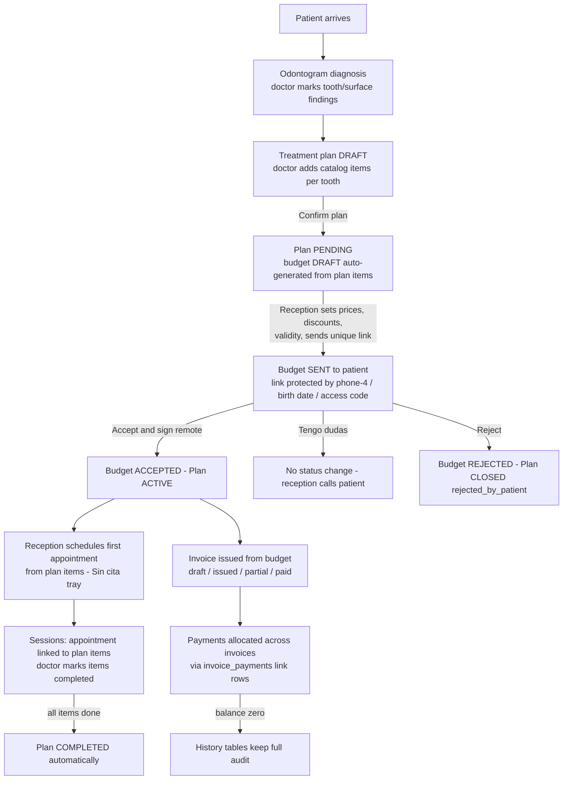

# DentalPin reverse-engineering: workflows, flow-charts & gap analysis

> Study of [DentalPin](https://github.com/dentalpin/dentalpin) (open source, BSL 1.1 → Apache 2.0, FastAPI + Nuxt — same stack as us) done by reading its actual source, cloned read-only to `reference/dentalpin/` (git-ignored).
> Every claim below cites a file path in that clone. Verified against the repo dated October 2026.

---

## 1. Architecture at a glance

| Aspect | DentalPin | Our clinic app |
|---|---|---|
| Backend | FastAPI, module-per-folder (`backend/app/modules/<name>/`), 55+ modules | FastAPI, feature folders (`backend/app/<domain>/`), ~10 domains |
| DB | PostgreSQL, **UUID PKs**, every table has `clinic_id` (multi-tenant, one tenant per clinic) | PostgreSQL, int PKs, single-tenant (one clinic = one install) |
| Frontend | Nuxt 4 | Nuxt 4 (same) |
| Auth | JWT access+refresh, **Role/RolePermission DB tables** (custom roles per clinic), 5 built-in roles | Session cookie, 3 fixed roles (owner/dentiste/reception) |
| Events | Internal event bus + webhooks + API | None (direct service calls) |
| Docs | `docs/technical/<module>/` per-module overview/permissions/events + ADRs | README only |

Key structural win on their side: **modules are decoupled by cross-reference ids and snapshot columns, never cross-imports between module models** (e.g. `Treatment.budget_item_id` is a bare UUID — `odontogram/models.py:110`; budget items carry `plan_status_snapshot` as a *copy*, not a relation — `budget/models.py:139`).

---

## 2. The clinical-financial chain (the core workflow)

Their patient journey is documented in-repo (`docs/workflows/plan-budget-flow.md`) and matches the code:

### 2.1 Odontogram model (`backend/app/modules/odontogram/models.py`)

Four tables — biggest conceptual difference vs ours:

| Their table | Role | Our equivalent |
|---|---|---|
| `tooth_records` (:38) | **Current state per tooth**: `general_condition` (healthy/caries/filling/crown/missing/root_canal/implant/extraction_indicated/sealant/fracture — `constants.py ToothCondition`), `surfaces: JSONB` dict keyed by single letters M/D/O/V/L, per-tooth notes, orthodontic flags `is_displaced`/`is_rotated` | `tooth_states` — similar but only 6 conditions, no per-tooth notes, no positional flags |
| `treatments` (:75) | **Clinical acts, one decision = one row**: `clinical_type` (35+ types driving rendering), `scope` (tooth / multi_tooth / global_mouth / global_arch), `status` planned|performed, `recorded_at`/`performed_at`/`performed_by`, **price+duration+VAT snapshots**, `budget_item_id`, soft delete | Only surface carie/obturation + 4 whole states; no separate act log |
| `treatment_teeth` (:163) | Per-tooth member of a treatment: `role` (pillar/pontic/cantilever for bridges), `surfaces: JSONB` | ❌ nothing comparable |
| `odontogram_history` (:196) | Append-only per-tooth change log: old/new condition, surface, who, when | ❌ none (history was out of the approved scope in our build) |

Capabilities we lack, confirmed in code:
- **Planned vs performed** distinction on the chart (`TreatmentStatus`).
- **Rendering driven by data** — `VisualizationRule` enum (`pulp_fill`, `occlusal_surface`, `lateral_icon`, `pattern_fill`) maps clinical type → drawing rule, instead of hard-coded UI logic.
- **Time travel**: `GET /patients/{id}/odontogram/at?date=` + `/timeline` endpoints (module API surface doc) — replay the chart at any past date.
- **Bulk tooth edit**: `PATCH /patients/{id}/teeth/bulk`.
- Root canal with 3 progress states (full/two-thirds/half) + post + overfill; crown-on-implant variants; veneer/inlay/overlay; ortho bracket/tube/band types.

### 2.2 Treatment plan → budget linkage (`treatment_plan/` + `budget/`)

- Plan statuses `draft → pending → active → completed → archived`, terminal alternative `closed` with `closure_reason` enum (rejected_by_patient / expired / cancelled_by_clinic / patient_abandoned / other) — `treatment_plan/models.py:56-59`.
- Plan items (`planned_treatment_items:125`) have per-item status `pending|completed|cancelled` and **multi-session rows** (`planned_treatment_item_sessions:195`); root canal and crowns are the documented multi-session examples.
- Confirming a plan auto-generates the draft budget from plan items; **the plan stays editable while the budget is draft** (budget lines mirror plan lines; adding/removing treatments in the plan updates the budget), and locks once the budget is sent (`plan-budget-flow.md` §2-4). Budget rows carry `version` + `parent_budget_id` for renegotiation chains (`budget/models.py:44-49`).
- Budget statuses `draft, accepted, completed, rejected, expired, cancelled` (`budget/models.py:54-56`); `BudgetSignature` (:257) stores the patient e-signature; `BudgetHistory` (:318) + `BudgetAccessLog` (:360) give the audit trail; the patient link is verification-protected (last-4 of phone → birth date → reception access code; brute-force lockout at 10 total or 5 per 15 min — `docs/adr/0006-budget-public-link-2-factor-auth.md`).
- **Bridge to the chart**: `Treatment.budget_item_id` (:122) connects a proposed/performed tooth treatment to its quote line — this is how planned marks and the money pipeline stay in sync.

### 2.3 Invoice & payments (`billing/`)

- `invoices` statuses `draft, issued, partial, paid, cancelled, voided` (`billing/models.py:105-107`) with **credit notes** (`credit_note_for_id`) and **numbering series** per type (`invoice_series:42`, invoice vs credit_note; also Veri*Factu/Spain and GST/India compliance modules).
- **`invoice_payments` link table (:288)**: one Payment may allocate across several invoices, one Invoice collects via several Payments; `total_paid`/`balance_due` are **computed, never stored** (docstring :294-296). Our payments are patient-level only — no invoice entity exists.
- Price snapshots at creation everywhere (budget items, invoice items, odontogram treatments) → history immune to catalog edits.

### 2.4 Agenda (`agenda/`)

- Appointments start at `scheduled` (:101); extra columns vs ours: **`cabinet_id` (room)**, `color`, denormalized `current_status_since` (lets the calendar show "waiting 12 min" without joining history), plus a **kanban view** (`kanban_service.py`).
- `AppointmentStatusEvent` history ≈ our `appointment_events`.
- **Appointment ↔ plan binding**: `appointment_treatments` rows (`treatment_plan/models.py:241`) schedule specific plan items per appointment; reception trays ("Sin cita", "Sin próxima cita") chase stalled plans.
- Recalls module: monthly due list (`recalls/models.py:78`), per-attempt logging (`RecallContactAttempt:139`), settings + statuses, anti-spam `do_not_contact` flag on the patient.

### 2.5 Roles & tenancy (`core/auth/`, `core/tenancy/`)

- Real **Role + RolePermission DB tables**; permissions are dotted strings (`patients.read`, `admin.roles.write` — `permissions.py:41`); five default roles (admin, dentist, hygienist, assistant, receptionist); "professional" status decoupled from role so an admin can also treat (`auth/models.py:205-209`).
- Multi-tenancy: every table carries `clinic_id`; one tenant == one clinic (self-hosted case, `tenancy/context.py`).

### 2.6 Reports (`reports/`)

Service files: billing (summary, overdue, by payment method, by professional, VAT, numbering gaps, aging buckets, issued trend), budget (summary, by professional, by treatment), scheduling/appointment lifecycle, operational, patients — `reports/services/*.py`, all with CSV export (`_csv_response`).

---

## 3. Patient record comparison

| Feature | DentalPin | Us | Gap |
|---|---|---|---|
| Names/phones/address/notes | ✅ | ✅ + wilaya, tel2 | — |
| `date_of_birth` | ✅ required before some flows | ✅ added 2026-10-10 | done |
| Gender, national ID, profession, language, photo | ✅ | ❌ | minor |
| Billing identity (NIF, billing name/address/email) | ✅ | ❌ | needed for corporate invoicing |
| GDPR consent + `do_not_contact` | ✅ | ❌ | minor |
| Patient timeline / activity journal | ✅ | ❌ (admin audit_log only) | medium |
| Medical profile flags | via medical_reference module | ✅ 8 flags | equal |

---

## 4. Gap table & prioritized backlog for our app

### Small wins (≈ hours each)
1. **Tooth-state audit hook** — we already call `log_action()`; add a tooth_state history write on every odontogram PUT (mirrors their `odontogram_history`). Best value/effort in the whole list.
2. **Revenue reports + CSV** (by treatment, by period) — mirror `reports/services/billing.py`; we already store everything needed.
3. **Réactivation/relance list** — patients whose last visit > N months, as a dashboard card (simplified version of their recalls).
4. **No-show rate + agenda stats by period** — `absent_at` already exists; add counters.
5. **Planned-vs-performed look** — pure display change: render `a_traiter` in a distinct "proposed" style until its treatment exists. No schema change.

### Modules (≈ days each)
6. **Devis (devis/budget)** — the missing pipeline piece: plan → devis → acceptation → facture. Copy their state machine (draft/sent/accepted/rejected/expired) but skip the remote patient link in v1 (acceptance in-clinic or by phone).
7. **Facture entity + allocation table** — invoice-scoped payments via an `invoice_payments`-style link table; keep patient-level payments working as the default allocation. Prerequisite for real monthly accounting.
8. **Odontogram v2 schema** — add scope/status/performed_by/price_snapshot/budget_item_id equivalents + a bridge-role table (pillar/pontic) to our data model; UI stays as-is, enables planned-vs-performed and history.
9. **Périodogramme** — per-tooth probing depths on 6 surfaces; natural addition for parodontal follow-up.
10. **Note templates** — quick-pick motifs for notes/reception (their clinical-notes templates, simplified).

### Big rethinks (≈ weeks)
11. **Full plan pipeline** (reception trays, per-session execution, auto-complete, budget versioning) — only after #6 + #7 prove demand.
12. **Multi-cabinet tenancy** — only if selling to other clinics.

### Deliberately skipped (not applicable to a single Algerian cabinet today)
Copilot/LLM agents, imaging AI, telephony/WhatsApp/SMS, payroll, purchase orders/suppliers, country tax compliance (Veri*Factu, GST, nav_online, sistema_ts).

---

## 5. Cross-check index (source citations)

- Odontogram tables/enums: `reference/dentalpin/backend/app/modules/odontogram/models.py` (:38, :75, :122, :163, :196), `.../odontogram/constants.py` (ToothCondition, surfaces, TreatmentType, VisualizationRule).
- Plan ↔ budget human doc: `reference/dentalpin/docs/workflows/plan-budget-flow.md` §2-4; ADR `docs/adr/0006-budget-public-link-2-factor-auth.md`.
- Plan statuses/sessions/appointment links: `.../treatment_plan/models.py:56-59,125,195,241`.
- Budget status/versions/signature/history: `.../budget/models.py:33-56,178-215,257-378`.
- Invoice/credit/series/payment allocation: `.../billing/models.py:35-56,72-130,213,288-324`.
- Agenda: `.../agenda/models.py:49,72-130`; kanban `.../agenda/kanban_service.py`.
- Recalls: `.../recalls/models.py:78-139`.
- Roles/permissions/tenancy: `.../core/auth/permissions.py:32-79`, `.../core/auth/models.py:80-217`, `.../core/tenancy/context.py`.
- Reports: `.../reports/services/`.
- Demo credentials: `reference/dentalpin/README.md:19` (`admin@demo.clinic` / `demo1234`).
